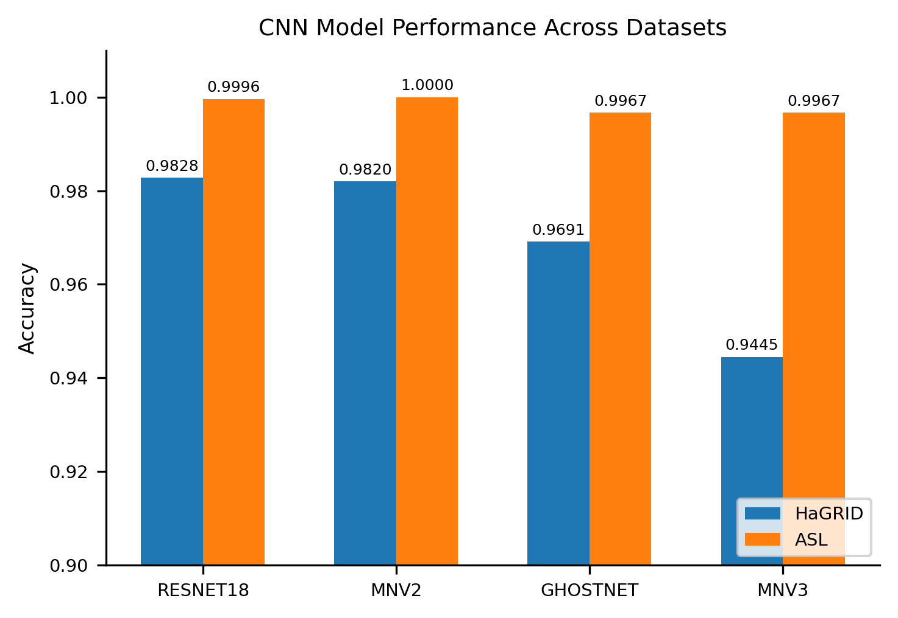
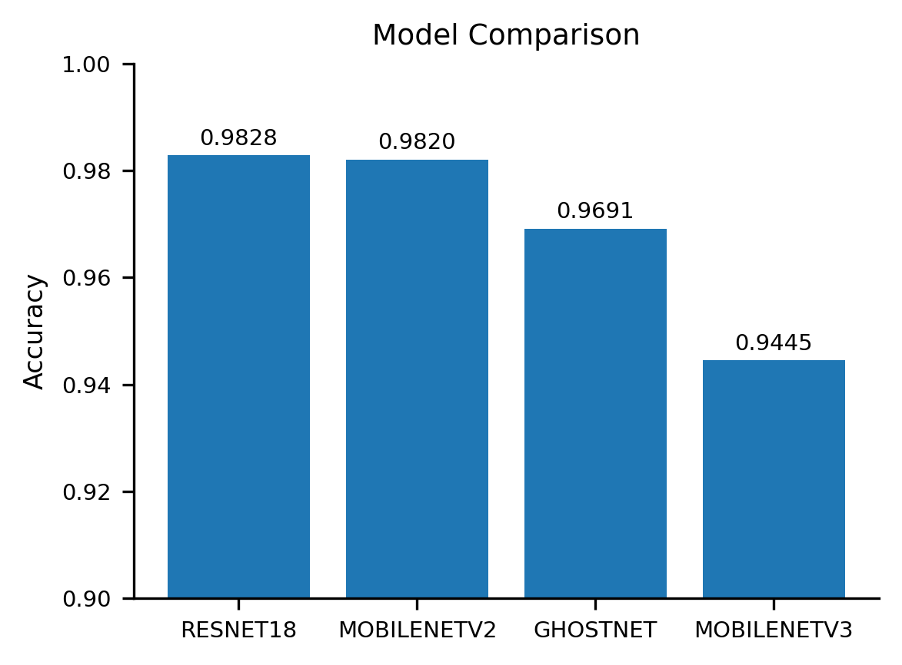
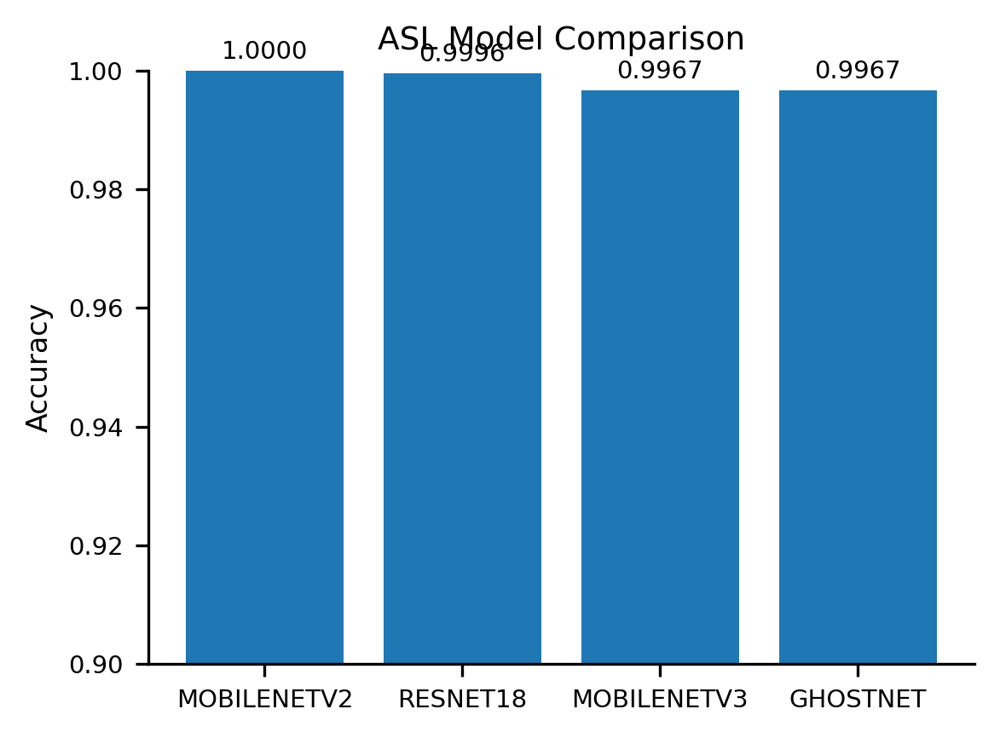

# Hand Gesture Recognition Benchmark (ASL Alphabet & HaGRID)

A PyTorch image classification benchmark comparing four lightweight Convolutional Neural Network (CNN) architectures—**ResNet-18**, **MobileNetV2**, **GhostNet-100**, and **MobileNetV3-Small**—across two hand gesture datasets (**ASL Alphabet** and **HaGRID**), including evaluation visualizations and TorchScript Lite export for Android deployment.



---

## Evaluation Results

All four architectures were fine-tuned from ImageNet-1K pretrained weights at `128×128` input resolution for 20 epochs using the same training pipeline (`Adam`, `lr=0.0001`, `batch_size=32`).

| Model | Backbone | HaGRID Test Accuracy (18 classes) | ASL Alphabet Test Accuracy (27 classes) |
| :--- | :--- | :---: | :---: |
| **ResNet-18** | `torchvision.models.resnet18` | **0.9828** | 0.9996 |
| **MobileNetV2** | `torchvision.models.mobilenet_v2` | 0.9820 | **1.0000** |
| **GhostNet-100** | `timm` (`ghostnet_100`) | 0.9691 | 0.9967 |
| **MobileNetV3-Small** | `torchvision.models.mobilenet_v3_small` | 0.9445 | 0.9967 |

<p align="center">
  
  
</p>

---

## Datasets

> **Note:** Raw datasets and trained model weights (`*.pth`, `*.pt`) are excluded from version control via `.gitignore`.

### 1. ASL Alphabet (`dataset_alphabet/`)
- **Total images:** 24,423 across **27 classes** (`A`–`Z` and `Blank`)
- **Split (70% / 20% / 10%):**
  - `train/`: 17,133 images
  - `val/`: 4,860 images
  - `test/`: 2,430 images

### 2. HaGRID (`dataset_hgrid/`)
- **Total images:** 126,931 across **18 gesture classes** (`call`, `dislike`, `fist`, `four`, `like`, `mute`, `ok`, `one`, `palm`, `peace`, `peace_inverted`, `rock`, `stop`, `stop_inverted`, `three`, `three2`, `two_up`, `two_up_inverted`)
- **Split (70% / 20% / 10%):**
  - `train/`: 88,892 images
  - `val/`: 25,344 images
  - `test/`: 12,695 images

---

## Training & Augmentation Pipeline

Both `alphabet/alphabet_train.py` and `hgrid/Hgrid_train2.py` use a unified fine-tuning setup:

- **Input Size:** `128 × 128` RGB
- **Normalization:** ImageNet mean `[0.485, 0.456, 0.406]`, std `[0.229, 0.224, 0.225]`
- **Train Augmentations:** `RandomHorizontalFlip`, `RandomRotation(20)`, `ColorJitter(brightness=0.4, contrast=0.4)`
- **Loss & Optimizer:** `CrossEntropyLoss`, `Adam(lr=0.0001)`
- **Epochs / Batch Size:** `20` epochs, batch size `32`

Earlier exploratory baselines for HaGRID are also preserved in `hgrid/`:
- `hgrid/train1.py`: Custom 2-layer CNN (`64×64` input, 5 epochs, val accuracy `0.4553`)
- `hgrid/train2.py`: `MobileNetV2` trained from scratch (`weights=None`, 10 epochs, val accuracy `0.9457`)
- `hgrid/Hgrid_train1.py`: `MobileNetV2` with frozen feature extractor (`15` epochs)

---

## Project Structure

```text
.
├── compare.py                              # Generates cross_dataset_model_comparison.png
├── cross_dataset_model_comparison.png      # HaGRID vs ASL accuracy chart
├── dual_dataset_comparison.png             # Dual-dataset accuracy comparison chart
├── mini_model_comparison.png               # HaGRID accuracy bar chart
├── mini_asl_model_comparison.png           # ASL Alphabet accuracy bar chart
├── confusion_matrix_*.png                  # HaGRID normalized confusion matrices
├── alphabet_confusion_matrix_*.png         # ASL Alphabet normalized confusion matrices
│
├── alphabet/
│   ├── split_dataset.py                    # 70/20/10 train/val/test splitter for ASL Alphabet
│   ├── alphabet_train.py                   # Fine-tunes selected backbone on dataset_alphabet/
│   ├── evaluate_model.py                   # Evaluates all 4 models & saves confusion matrices
│   ├── curve_alphabet_*.png                # Train/val loss curves
│   ├── confusion_matrix_*.png              # Per-model confusion matrices
│   └── model_comparison.png                # ASL accuracy comparison plot
│
└── hgrid/
    ├── split_dataset.py                    # 70/20/10 train/val/test splitter for HaGRID
    ├── Hgrid_train2.py                     # Main fine-tuning script for dataset_hgrid/
    ├── Hgrid_train1.py                     # Baseline MobileNetV2 (frozen backbone)
    ├── train1.py                           # Baseline custom 2-layer CNN
    ├── train2.py                           # Baseline MobileNetV2 (from scratch)
    ├── evaluate_model.py                   # Evaluates all 4 models & saves confusion matrices
    ├── Convert_Universal.py                # TorchScript Lite export (ResNet18 / MNV2 / MNV3)
    ├── convertGhsotnet.py                  # TorchScript Lite export (GhostNet-100)
    ├── test.py                             # CUDA availability & GPU check
    ├── curve_*.png                         # Train/val loss curves
    ├── confusion_matrix*.png               # Per-model confusion matrices
    └── model_comparison.png                # HaGRID accuracy comparison plot
```

---

## Usage

### 1. Environment Setup

Create a Python virtual environment and install the required dependencies:

```bash
python -m venv venv
# Windows:
venv\Scripts\activate
# Linux/macOS:
# source venv/bin/activate

pip install torch torchvision timm torchmetrics scikit-learn matplotlib seaborn numpy tqdm
```

Check CUDA availability:

```bash
python hgrid/test.py
```

### 2. Prepare Datasets

Place your raw class folders in the source directory configured in `split_dataset.py`, then run the 70/20/10 splitter:

```bash
python alphabet/split_dataset.py
python hgrid/split_dataset.py
```

### 3. Train Models

Edit `MODEL_NAME` (`"mobilenetv2"`, `"mobilenetv3"`, `"resnet18"`, or `"ghostnet"`) in the training script and run from the repository root:

```bash
python alphabet/alphabet_train.py
python hgrid/Hgrid_train2.py
```

### 4. Evaluate & Compare

Run the evaluation scripts from the repository root (the scripts load weights from `alphabet/` and `hgrid/` and datasets from `dataset_alphabet/` and `dataset_hgrid/`):

```bash
python alphabet/evaluate_model.py
python hgrid/evaluate_model.py
python compare.py
```

### 5. Export for Android (TorchScript Lite)

Convert trained `.pth` weights to `.pt` TorchScript Lite models (`1×3×128×128` traced input):

```bash
cd hgrid
python Convert_Universal.py   # Set MODEL_NAME to "mobilenetv2", "mobilenetv3", or "resnet18"
python convertGhsotnet.py     # Exports model_ghostnet.pt
```
